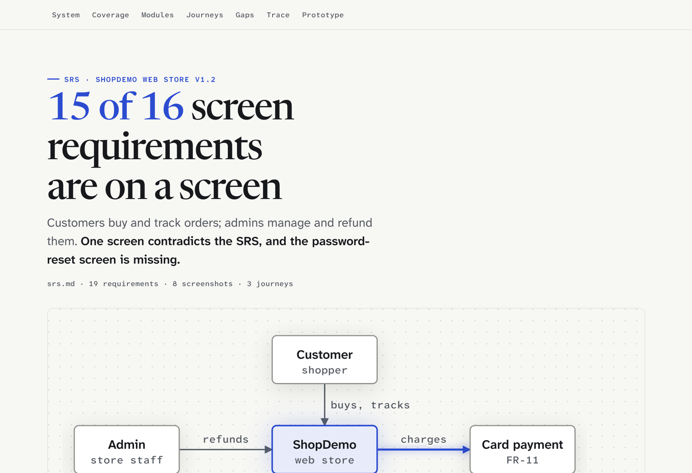
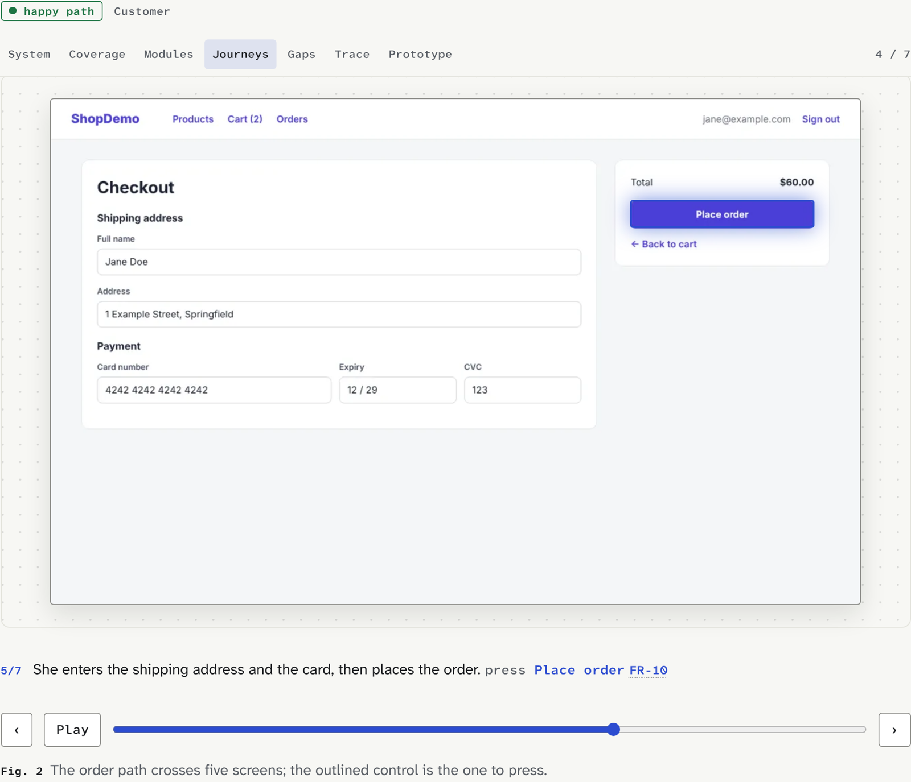
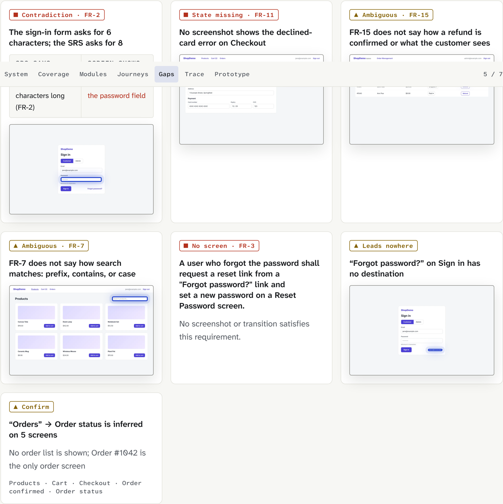
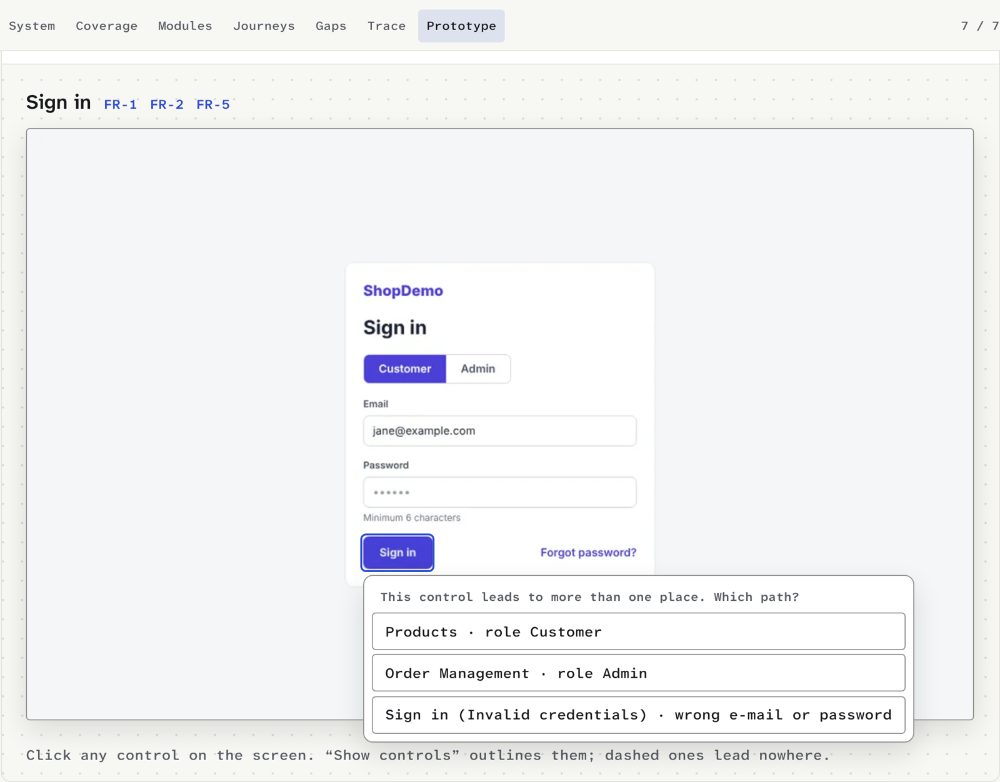
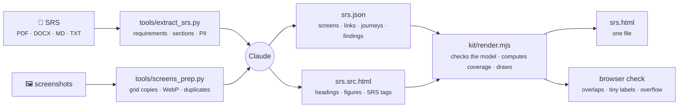

<div align="center">

# EsyAch

**Turn a requirements document, and the screenshots that go with it, into one page a team can read in ten seconds.**

Coverage, journeys, contradictions, missing screens, a trace table and a clickable prototype, drawn from your SRS.<br>
Plus every visual-explainer mode for code, diffs, plans and slides.

[Install](#install) · [SRS explainer](#explain-an-srs) · [SRS review](#review-an-srs) · [Other modes](#every-other-mode) · [How it works](#how-it-works) · [Credits](#credits)

</div>



## Install

In Claude Code:

```text
/plugin marketplace add devshrawin/EsyAch
/plugin install esyach@esyach
```

You need Node 18+ and Python 3.9+, with Pillow for screenshots and `pypdf` (or `pdftotext`) for PDF requirements. The browser check uses Playwright when it is installed.

```text
/esyach:srs-explain requirements.pdf --screens ./screenshots   # SRS + screenshots → explainer with coverage and prototype
/esyach:srs-explain requirements.docx                          # the document alone
/esyach:srs-review  requirements.md                            # audit the writing before the build
```

The page is written to `.esyach/srs.html` beside the SRS. Double-click it to open it in any browser.

## Explain an SRS

| | |
|---|---|
| **The answer first** | The headline is the verdict with its number. The lead names the two problems that matter. |
| **Coverage** | Which UI requirements appear on a screen, with contradictions, gaps and open questions counted. Gaps are **computed** from the screens, not guessed. |
| **Journeys** | One stepper per role: the screen of each step, the control to press outlined, and the requirement it shows. |
| **Gaps** | Small multiples: *the SRS says 8 characters, the screen says 6*, *no Reset Password screen*, *"Forgot password?" leads nowhere*. |
| **Decisions** | Each decision only you can make is a question on the page. Your answers go back to Claude in one reply. |
| **Trace** | Every requirement, its screens and its status. Hover a row and its screens light up everywhere. |
| **Prototype** | Click through the screenshots. A control with several outcomes asks which path to take. Dashed controls lead nowhere. |







An SRS without IDs like `FR-1` still works. Every *shall / must / should* statement is numbered `R-001`, `R-002`, … and the page says so. Real-looking e-mails, phone numbers and card numbers in the SRS are flagged before anything is shared.

## Review an SRS

`/esyach:srs-review` judges the document itself: ambiguous wording, untestable targets, requirements that conflict, unspecified error states, and missing NFR areas. You get a verdict first, then one card per problem, each with a suggested rewrite to accept or reject.

## Every other mode

EsyAch carries the whole [visual-explainer](https://github.com/nicobailon/visual-explainer) toolkit. Each mode makes a figure-first HTML page instead of ASCII art:

| Command | Makes |
|---|---|
| `/esyach:generate-web-diagram` | an architecture, flow or concept page |
| `/esyach:diff-review` | a visual review of a branch, commit or PR, with a fix to accept per risk |
| `/esyach:plan-review`, `/esyach:generate-visual-plan` | a plan you can answer, decision by decision |
| `/esyach:project-recap` | what changed in a time window |
| `/esyach:compare` | options drawn side by side, with a recommendation |
| `/esyach:fact-check` | a page's claims checked against the code |
| `/esyach:state-machine` | a state machine walked from your code, with every broken rule replayed |
| `/esyach:generate-slides`, `/esyach:generate-video` | a slide deck (`--pptx` too) or a narrated MP4 |

For a whole codebase, `tools/inventory.py` collects routes, calls, datastores and external SDKs with `file:line`, so architecture pages cite their evidence. Target code is never executed.

## How it works



- **Scripts collect facts.** Claude writes only a small model and the page's words. Requirements are read from the extraction, so the page cannot invent one.
- **The renderer refuses a wrong model.** It reports unknown IDs, boxes outside the image, a mapping with no reason, and a contradiction with one side missing, each with its JSON path.
- **Each screenshot is embedded once**, as WebP. The bundled example is 0.26 MB; the old canvas viewer made 2.2 MB.
- **The render looks at its own page** at 390 px and 1280 px. It lists every overlap or unreadable label and gives Claude one contact sheet to check.
- **Fonts** load from Google Fonts. Offline, the page falls back to system fonts. Nothing else is fetched.

Try it: open [`examples/shop-spec/.esyach/srs.html`](examples/shop-spec/.esyach/srs.html). It is built from a sample SRS and 8 mock screenshots with a planted contradiction (FR-2) and a planted gap (FR-3). The model behind it is [`srs.json`](examples/shop-spec/.esyach/srs.json).

## Tests

```sh
npm test   # version guard, kit, state machines, questions, SRS pages, Python tools
```

## Credits

EsyAch 2.0 is built on [visual-explainer](https://github.com/nicobailon/visual-explainer) by Nico Bailon (MIT), version 0.15.0. Its kit, renderer, browser check, reply loop, references and every non-SRS mode come from there. The SRS pipeline, model, tags and prototype are EsyAch's.

MIT licence: see [LICENSE](LICENSE).
