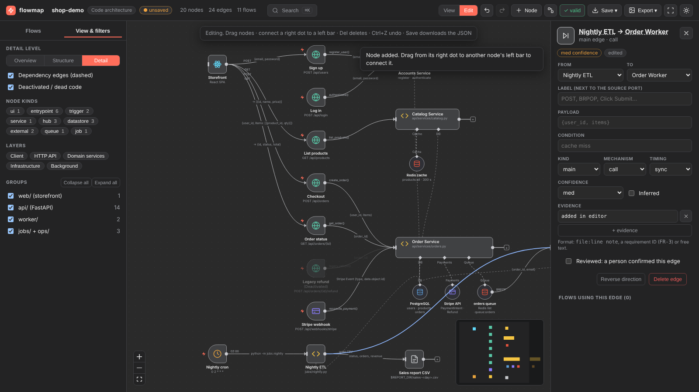
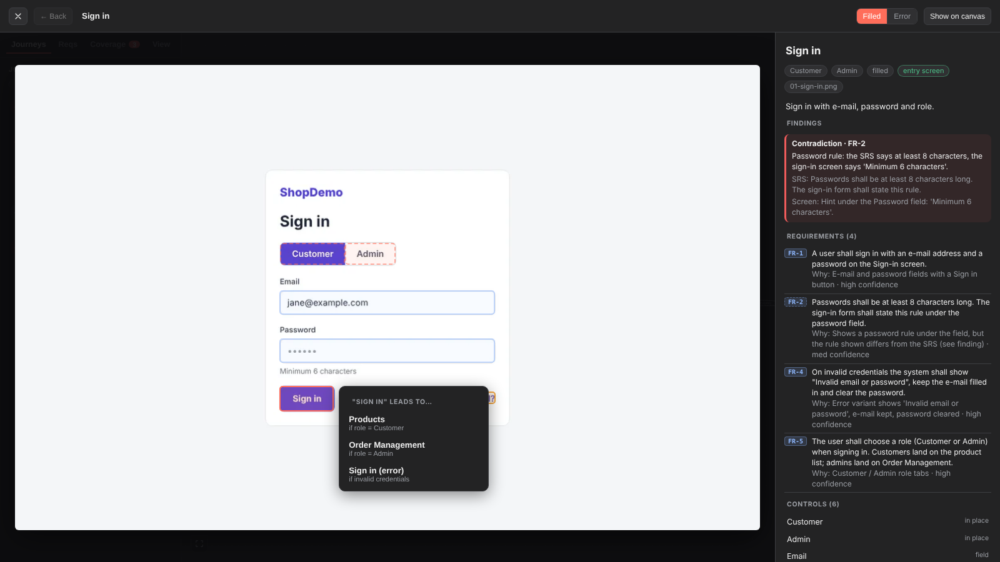
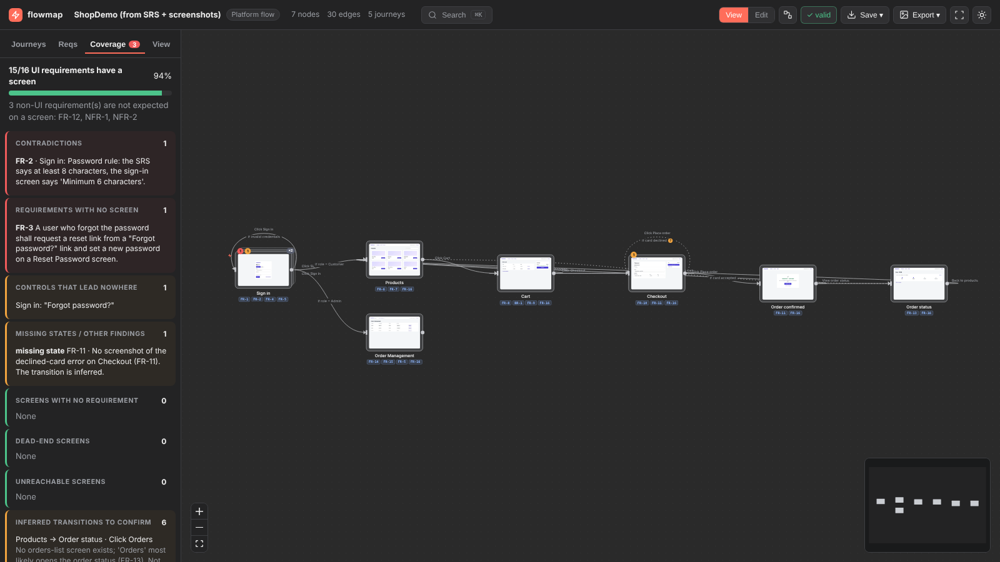

# flowmap

A Claude Code plugin that turns a **codebase** or an **SRS + screenshots** into a single offline HTML
file that looks like an n8n workflow canvas. Its flows are **named and replayable**: data paths in
code, user journeys in a spec.


## Install

```
/plugin marketplace add devshrawin/EsyAch
/plugin install flowmap@flowmap
```

Requires Python 3.9+. Nothing else: the viewer ships prebuilt.

## Use

```
/flowmap ./path/to/repo            # Mode A: local path
/flowmap https://github.com/o/r    # Mode A: shallow clone (never executed)
/flowmap ./repo.zip                # Mode A: zip (traversal/zip-bomb safe)
/flowmap spec srs.pdf --screens ./shots   # Mode B: SRS (PDF/DOCX/MD/TXT) + screenshots (folder or zip)
/flowmap-update                    # re-render after editing in the viewer
```

Output: `.flowmap/architecture.json` and `.flowmap/flowmap.html`. Open the HTML in any browser; it
makes no network requests.

## In the viewer

- **Flows**: pick one to dim everything else, then Play / Step (space, ← →) to follow the data.
- **View & filters**: Overview / Structure / Detail, filter by kind or layer, collapse groups. **Ctrl/Cmd+K** searches.
- **Edit**: drag, rename, reconnect, add or delete nodes and edges, mark items reviewed, build or fix
  flows (Record = click edges). Undo with Ctrl+Z. **Save** downloads `architecture.json` (or an
  HTML with your edits). Then run `/flowmap-update` to re-render without re-analysing.
- **Export**: PNG, SVG (vector), Mermaid, JSON, interactive HTML, Print/PDF (one page per flow).

| Edit mode | Collapsed groups | Vector export |
|---|---|---|
|  |  |  |

## Mode B: SRS + screenshots


- Every screen is a card with its screenshot. Requirement chips sit under the title, ×n marks states of
  the same screen, and red/amber badges mark gaps.
- **Click a screen** to open it full size. Every button, link, tab and field is a hotspot. **Click a
  hotspot to go where it leads**, with Back and a breadcrumb, so you can use the platform like a
  prototype. A control with several outcomes (Sign in by role, Place order accepted/declined) asks
  which one you want.
- **Journeys**: pick one and press *Walk through the screens*. The control to use pulses, and the
  requirement text sits beside it.
- **Reqs**: pick a requirement to light up every screen and transition that satisfies it. Requirement
  chips inside a screen work the other way.
- **Coverage**: requirements with no screen, contradictions between the SRS and the screens, controls
  that lead nowhere, missing states, dead ends, unreachable screens, and inferred transitions to confirm.
- **Edit**: draw, move or resize hotspots on a screenshot, link them to screens, confirm inferred
  transitions, and link or unlink requirements. Coverage updates live.
- **Export**: a single-file **clickable prototype**, and a **PDF flow book** (coverage, then every
  journey step with its screenshot and the highlighted control).

| Prototype | Walkthrough | Coverage |
|---|---|---|
|  |  |  |

## Status

All four stages are done. See [docs/PLAN.md](docs/PLAN.md). QA: [docs/QA.md](docs/QA.md) (audit and
test cases). Graph format: [docs/schema.md](docs/schema.md).

## Develop

```
python3 scripts/inventory.py examples/shop-demo -o /tmp/inv.json
python3 scripts/validate.py examples/shop-demo/.flowmap/architecture.json --root examples/shop-demo
(cd viewer && npm install && npm run build)     # only after viewer changes
tests/render_examples.sh                        # rebuild, validate, render, screenshot
tests/run_all.sh                                # unit + browser + 600-node perf tests
python3 tests/qa.py                             # full QA: ~130 cases -> docs/qa-results.md
node examples/shop-spec/_make/make_screens.cjs  # regenerate the Mode B fixture screenshots
```
