<div align="center">


<p>
  <a href="#-install"></a>
  <a href="docs/QA.md"></a>
  
  
  <a href="LICENSE"></a>
</p>

**Point it at a codebase, or at a requirements doc plus screenshots.<br>
Get an interactive, n8n-style map you can replay, click through, edit and share.**

[Install](#-install) · [Code maps](#-map-any-codebase) · [SRS → prototype](#-turn-an-srs--screenshots-into-a-clickable-prototype) · [Coverage](#-catch-the-gaps-before-they-ship) · [Edit](#-fix-it-yourself) · [Export](#-take-it-anywhere) · [FAQ](#-faq)

</div>

---

## ✨ Why flowmap

Most diagram tools draw boxes and arrows. flowmap shows **what actually happens**, as named flows you can **press Play on**:

- 🧭 **"What happens when a user clicks Pay?"** Watch the request travel from the button to the API, the database, Stripe, the queue, the worker and the e-mail. Every step links to the exact `file:line`.
- 📱 **"Does the app match the spec?"** Turn an SRS and a folder of screenshots into a **clickable prototype**, and get a list of **missing screens, contradictions and dead buttons**.
- 🪄 **"The map is slightly wrong."** Fix it in the browser, save, re-render. Your edits survive the next analysis.
- 🔒 **Everything stays on your machine.** The output is one self-contained HTML file that makes zero network requests.

<br>

## 🚀 Install

In Claude Code:

```text
/plugin marketplace add devshrawin/EsyAch
/plugin install flowmap@flowmap
```

You need Python 3.9+. Nothing else: the viewer ships prebuilt.

```text
/flowmap ./my-project                                   # a folder
/flowmap https://github.com/acme/shop                   # a repo (shallow clone, never executed)
/flowmap ./shop.zip                                     # a zip
/flowmap spec requirements.pdf --screens ./screenshots  # SRS (PDF/DOCX/MD/TXT) + screenshots (folder or zip)
```

Claude prints the path of the result. **Double-click `.flowmap/flowmap.html`** and it opens in any browser.

<br>

## 🧭 Map any codebase

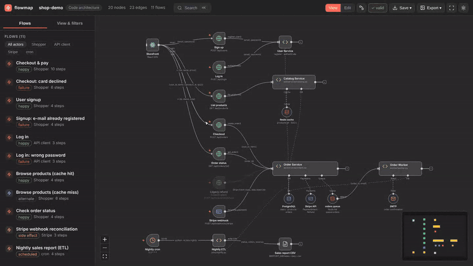

Claude reads the project (Python deeply; JS/TS, Go, Java and others by pattern) and builds:

| | |
|---|---|
| ⚡ **Entry points** | HTTP routes, webhooks, cron jobs, CLIs, queue consumers. They carry the red bolt, the same as n8n triggers. |
| 🧩 **Services as hubs** | The parts doing the work, with their **databases, caches, queues and SDKs** hanging underneath on dashed lines. |
| 🎬 **Replayable flows** | One per entry point, **plus the failure paths** (card declined → 402, duplicate e-mail → 409) and side effects (enqueue → worker → e-mail). |
| 🔎 **Evidence everywhere** | Every box, line and step cites `file:line`. Guesses are marked as guesses, with a confidence level. |
| 💤 **Dead code** | Feature-flagged-off routes appear dimmed as *(Deactivated)*; commented-out routes are reported. |

Detail levels (Overview / Structure / Detail), filters, groups you can collapse, and **Ctrl/Cmd + K** search keep big codebases readable. 600+ nodes render in about a second.

<br>

## 📱 Turn an SRS + screenshots into a clickable prototype

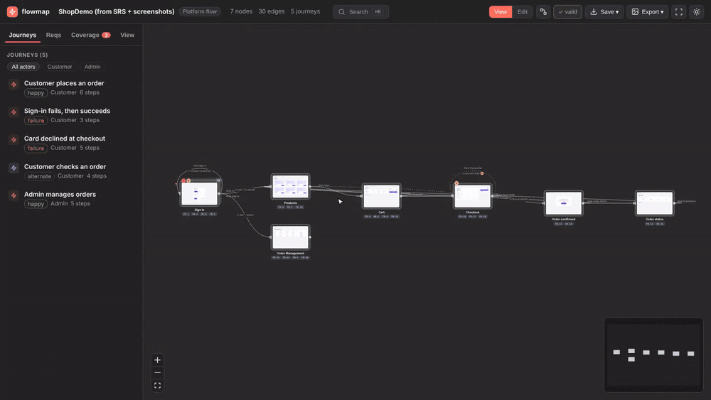

- Every screenshot becomes a **screen card**, with the requirements it satisfies (`FR-1`, `FR-5`…) underneath.
- Every button, link, tab and field becomes a **hotspot**. **Click it to go where it leads**, with Back and breadcrumbs, the same as the real app.
- A button with several outcomes (*Sign in as Customer or Admin*, *card accepted or declined*) asks which path you want.
- **Journeys** per role ("Customer places an order", "Admin refunds an order") play screen by screen. The control to press **pulses**, and the requirement text sits next to it.
- Different states of one screen (empty, error, success) stack into one card, marked ×2.

<br>

## 🎯 Catch the gaps before they ship

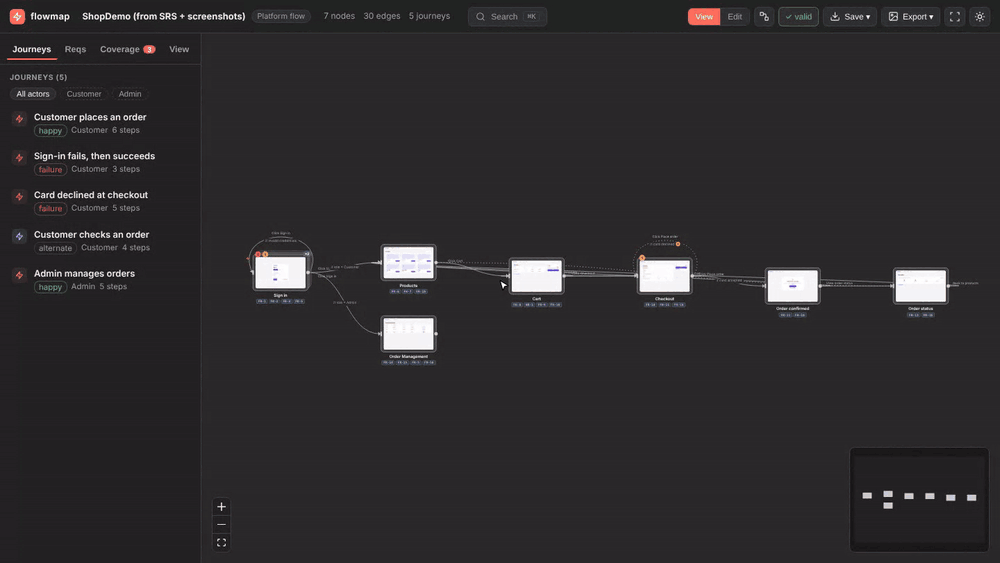

The **Coverage** panel cross-checks the SRS against the screens:

| | Example from the bundled demo |
|---|---|
| 🔴 **Contradictions** | *FR-2 says passwords need 8+ characters; the sign-in screen says "Minimum 6".* |
| 🔴 **Requirements with no screen** | *FR-3: there is no "Reset password" screen.* |
| 🟠 **Controls that lead nowhere** | *"Forgot password?" goes nowhere.* |
| 🟠 **Missing states** | *No screenshot shows the declined-card error that FR-11 describes.* |
| 🟠 **Dead ends · unreachable screens · screens with no requirement** | Calculated, not guessed. |
| ❓ **Inferred transitions** | Dashed with a **?**, so you know what to confirm. |

Pick any requirement to **light up every screen and transition that satisfies it**. It works the other way too, from a screen to its requirements.

<br>

## 🪄 Fix it yourself

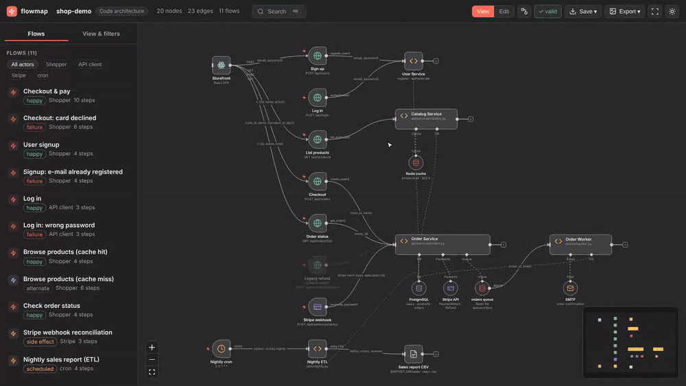

Switch to **Edit** and:

- drag, rename and re-describe anything; add or delete nodes and connections
- **draw hotspots on screenshots** and link them to screens
- rebuild flows step by step, or turn on **Record** and click edges
- tick **✓ Reviewed** on what you've checked
- Undo and redo; drafts survive a reload

**Save** downloads `architecture.json` (or `screens.json`). Run `/flowmap-update` and the map re-renders **without re-analysing**. A later full analysis keeps everything you marked reviewed.

<br>

## 📤 Take it anywhere

| Export | Best for |
|---|---|
| 🖼️ **PNG** · **SVG** (real vectors) | Slides, Figma, docs. Exports what you're looking at, with the selected flow highlighted. |
| 🧜 **Mermaid** | Pasting into GitHub / Markdown. |
| 🌐 **Interactive HTML** | Sending the whole explorer to someone. One file, works offline. |
| 📱 **Clickable prototype** | Stakeholders who just want to click through the screens. |
| 📄 **PDF flow book** | Reviews and sign-off: every flow or journey, step by step, with screenshots and the highlighted control. |
| `{ }` **JSON** | Your own tooling. |

<br>

## 🧪 Try the bundled examples

Download one (GitHub shows `.html` as source) and double-click it; nothing to install:

| File | What it shows |
|---|---|
| [`examples/shop-demo/.flowmap/flowmap.html`](examples/shop-demo/.flowmap/flowmap.html) | A small shop codebase (FastAPI, Postgres, Redis, Stripe, worker, cron): **11 flows**, including failures and a flagged-off route. |
| [`examples/shop-spec/.flowmap/flowmap.html`](examples/shop-spec/.flowmap/flowmap.html) | A shop SRS plus 8 mock screenshots: **5 journeys**, a clickable prototype, and a **planted gap and contradiction** for Coverage to catch. |

<details>
<summary><b>More screenshots</b></summary>
<br>

| | |
|---|---|
| 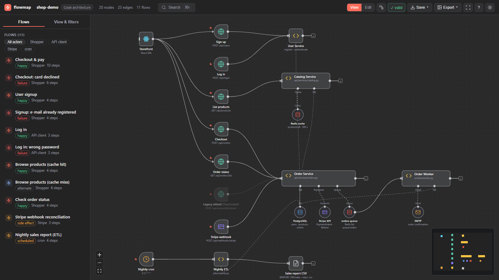 | 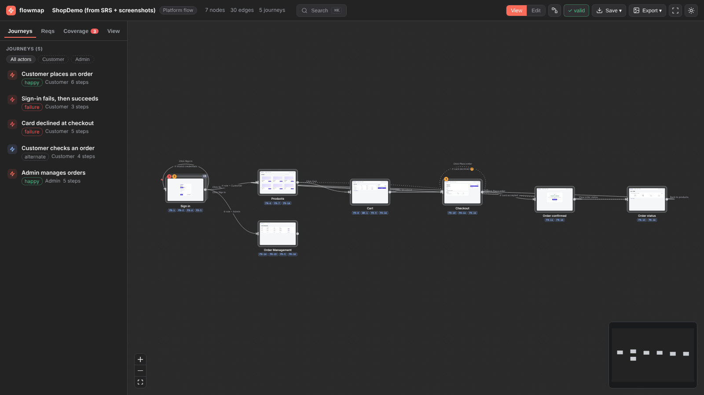 |
| Code map, n8n style | Screen map with gap badges |
| 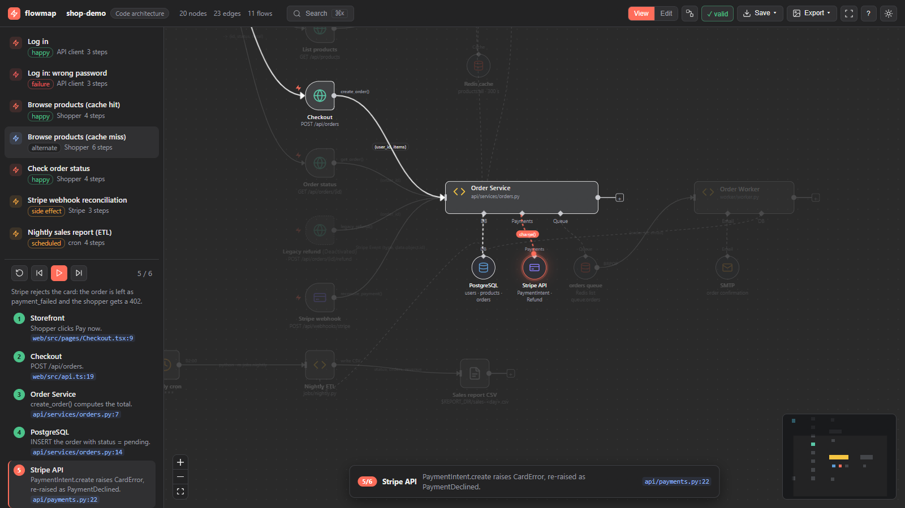 | 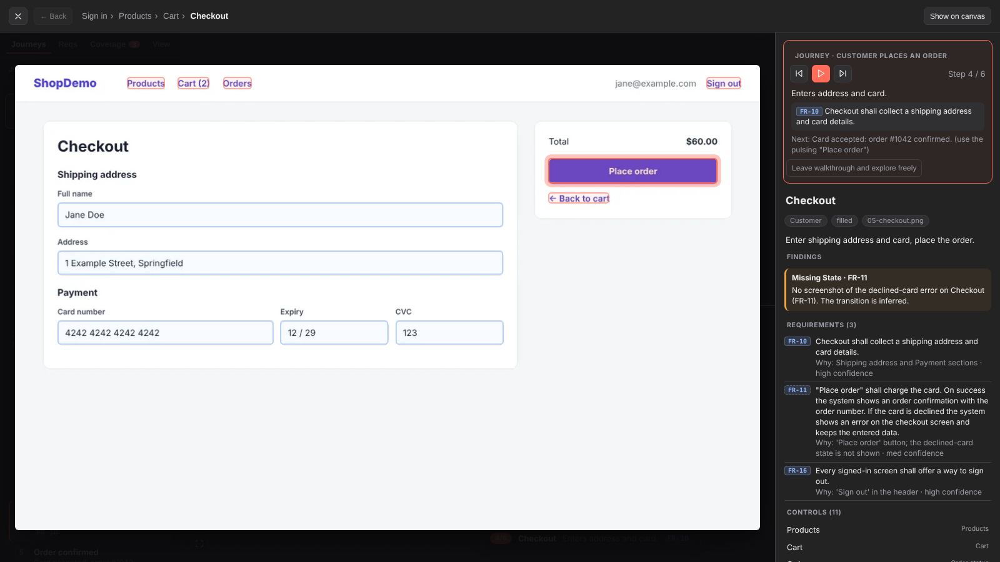 |
| Failure path (card declined) | Journey walkthrough |
| 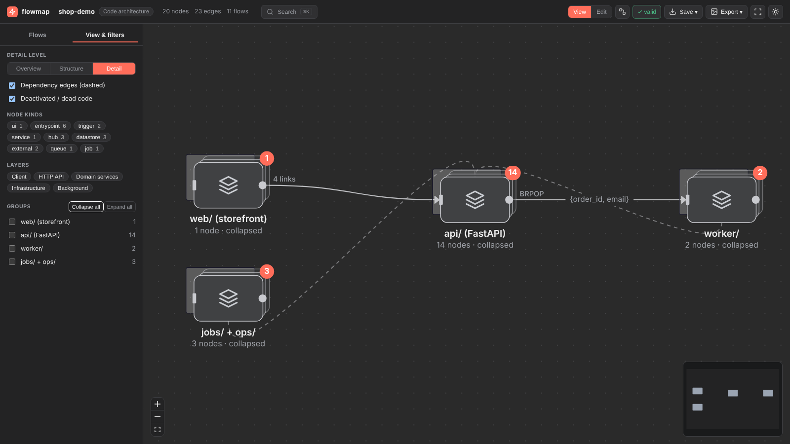 | 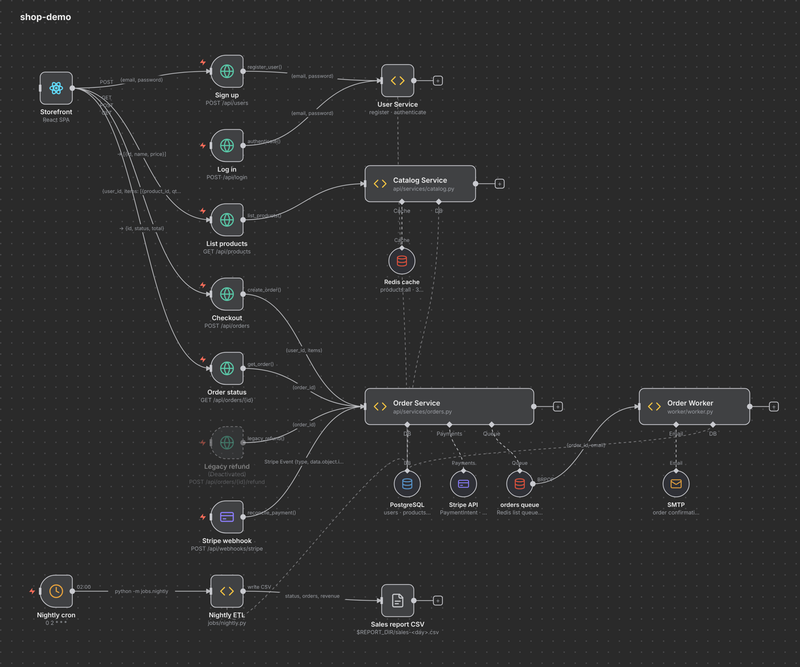 |
| Collapsed groups for big repos | SVG / PNG export |

</details>

<br>

## ⚙️ How it works

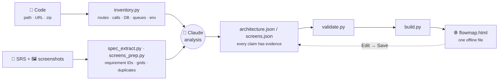

- **Deterministic scripts** collect facts (Python standard library, no installs). **Claude** turns them into flows and journeys, citing evidence. **`validate.py`** rejects anything without evidence or with a broken link.
- The viewer is React + React Flow + ELK, prebuilt into a single file and inlined with your data.

<br>

## 🔒 Private by design

- Your code, SRS and screenshots **never leave your machine**. The HTML makes **zero network requests** (checked in tests with every request blocked).
- Target code is **never executed or installed**. Repos are shallow-cloned with hooks off; `.git/config` is never even read.
- Zips are checked for path traversal, symlinks and zip bombs. Screenshots are size-capped.
- You're warned if an SRS or screenshot seems to contain **real personal data** (e-mails, phone and card numbers).

<br>

## ❓ FAQ

<details><summary><b>Which languages does the code map understand?</b></summary>

Python in depth (syntax tree: routes, call graph, feature flags, dead code). JavaScript/TypeScript by pattern (imports, cross-file calls, Express/Next/NestJS routes, fetch calls). Go, Java, Kotlin, Ruby, PHP, Rust and C# get a lighter pattern-based fallback. Claude reads the code itself to fill gaps and marks anything inferred.
</details>

<details><summary><b>How big a codebase can it handle?</b></summary>

Tested at 600+ nodes: about 1 s to render, with groups collapsed automatically by folder. Use Overview level and groups to zoom out; open a group to zoom in.
</details>

<details><summary><b>How accurate are the hotspots on my screenshots?</b></summary>

Claude reads each screenshot with a coordinate grid overlay. Boxes are usually close, and you can drag or resize any of them in Edit mode in seconds. Transitions the screenshots don't show are drawn dashed with a "?" and a reason.
</details>

<details><summary><b>Can I keep my corrections when I re-run the analysis?</b></summary>

Yes. Anything you edited or ticked **Reviewed** is kept. To just re-draw after editing, use `/flowmap-update`, which never re-analyses.
</details>

<details><summary><b>Does it work without Claude?</b></summary>

The viewer, validator and exports do. Any `architecture.json` / `screens.json` that follows [the schema](docs/schema.md) renders with `python3 scripts/build.py graph.json -o map.html`.
</details>

<br>

## 🛠️ Development

```bash
(cd viewer && npm install && npm run build)        # after viewer changes
tests/render_examples.sh                           # rebuild, validate, render the examples
python3 tests/qa.py                                # full QA: 140 cases → docs/qa-results.md
node docs/media/record.cjs                         # re-record the README animations
```

Docs: [schema](docs/schema.md) · [plan & limits](docs/PLAN.md) · [QA audit & test cases](docs/QA.md)

<br>

<div align="center">

**MIT licensed** · built as a [Claude Code](https://claude.com/claude-code) plugin<br>
<sub>If flowmap saved you an afternoon of reading code, give it a ⭐</sub>

</div>
